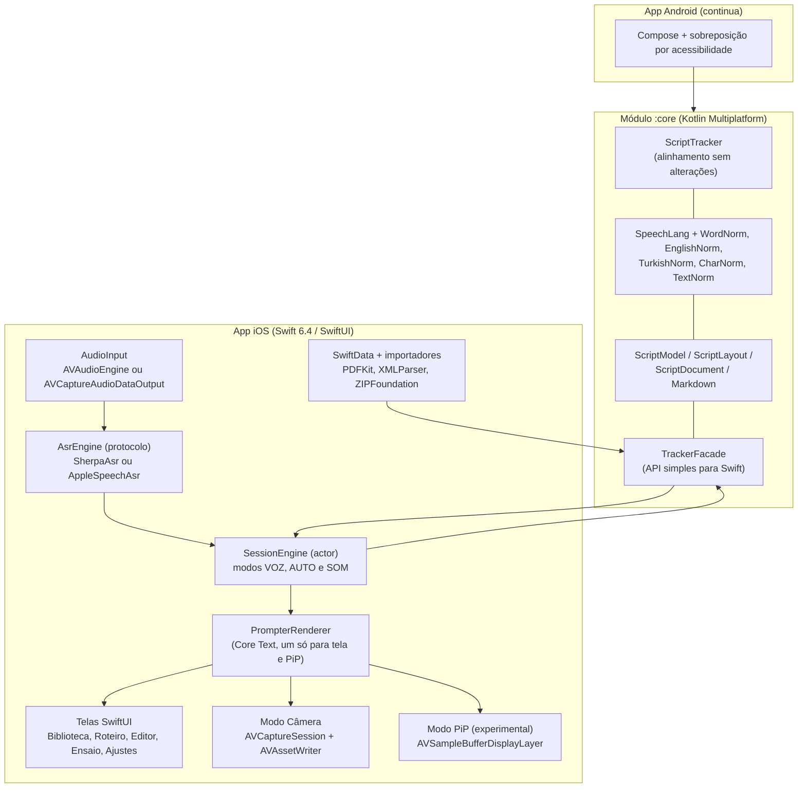
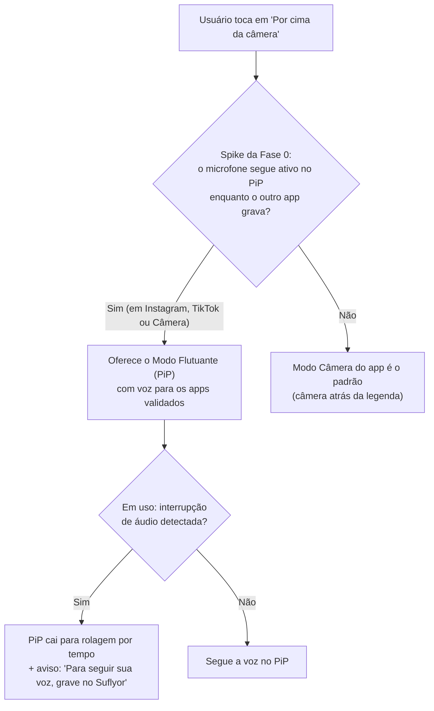

# Plano de migração do Suflyor para iOS

> Situação em 26/11/2026. Ponto de partida: o app Android deste repositório (Kotlin + Jetpack Compose, cerca de 10,5 mil linhas, sherpa-onnx 1.13.8, 14 idiomas de voz).
> Objetivo: um app iOS nativo que **mantenha o acompanhamento da leitura por voz** com o mesmo comportamento do Android, usando a pilha atual e estável da Apple. Onde a sobreposição em cima de outros apps não funcionar, o app usa **a câmera ao vivo atrás do texto**.

---

## 1. Resumo das decisões

| Tema | Decisão |
|---|---|
| Ferramentas | **Xcode 27** (estável desde 14/09/2026), **Swift 6.4** com concorrência estrita (modo de linguagem Swift 6), SDK do **iOS 27** |
| iOS mínimo | **iOS 26.0**. Dá acesso a `SpeechAnalyzer`, ao visual Liquid Glass, ao `@Observable` e ao SwiftData já maduros, além do controle remoto da câmera pelos AirPods |
| UI | **SwiftUI** + Observation. UIKit só onde for preciso (renderização do teleprompter, teclas de hardware) |
| Núcleo de acompanhamento | **Kotlin Multiplatform (KMP)**: o `ScriptTracker`, os normalizadores e o `ScriptModel` atuais saem para um módulo `:core`, compartilhado entre Android e iOS. **O algoritmo não é reescrito** |
| Reconhecimento de fala | **sherpa-onnx no iOS** (XCFramework + API Swift), com **os mesmos modelos ONNX e os mesmos pacotes de voz** (zip + SHA-256). O `SpeechAnalyzer` da Apple entra como motor opcional |
| Sobreposição em outros apps | **Não existe no iOS** como no Android. A única via é o **Picture in Picture (PiP)** com `AVSampleBufferDisplayLayer`, tratado como **modo experimental** |
| Plano B garantido | **Modo Câmera**: câmera frontal ao vivo em tela cheia **atrás da legenda**, com gravação de vídeo e áudio dentro do app, salva na galeria e compartilhável no Instagram e no TikTok |
| Dados | SwiftData para a biblioteca, `UserDefaults`/`@AppStorage` para as configurações, e backup em zip de Markdown **compatível com o Android** |
| Testes | `kotlin.test` no núcleo (rodando no JVM **e** no simulador iOS), Swift Testing no app, XCUITest nos fluxos principais |
| CI/Distribuição | GitHub Actions com runner macOS + Xcode 27 e TestFlight (fastlane ou Xcode Cloud). **Ver o risco de licença GPL na seção 9** |

---

## 2. Comparação entre Android e iOS

| Android (hoje) | iOS (alvo) | Observação |
|---|---|---|
| Jetpack Compose (`ui/`) | SwiftUI | Reescrita das telas: biblioteca, roteiro, editor, ensaio, configurações e diário |
| `PrompterAccessibilityService` + `TYPE_ACCESSIBILITY_OVERLAY` | **Não existe equivalente** | O iOS não permite janelas por cima de outros apps nem serviços de acessibilidade de terceiros |
| Janela flutuante (`OverlayController`) | PiP com `AVPictureInPictureController.ContentSource(sampleBufferDisplayLayer:)` | Experimental: a janela é do sistema, sem botões próprios, e o tamanho e a posição ficam com o usuário |
| Serviço em primeiro plano `microphone` | `UIBackgroundModes = audio` + `AVAudioSession` ativa | O microfone em segundo plano só continua se a sessão foi iniciada em primeiro plano |
| `AudioRecord` (fonte MIC) | `AVAudioEngine` (tap no `inputNode`) ou `AVCaptureAudioDataOutput` no Modo Câmera | Conversão para 16 kHz mono Float32 com `AVAudioConverter` |
| `RecordingMonitor` (vê quem grava) | Notificações de interrupção e de troca de rota da `AVAudioSession` | O iOS não mostra o que os outros apps estão gravando |
| sherpa-onnx `.aar` (JNI) | sherpa-onnx XCFramework + `SherpaOnnx.swift` | Mesmos modelos `.onnx`, `tokens.txt` e `bpe.vocab` |
| Bloco nas Configurações Rápidas | **Controle na Central de Controle** (`ControlWidget`) + **App Intents** (Atalhos, Siri, Botão de Ação) | Abre o app direto no Modo Câmera ou inicia o PiP |
| `CameraTarget` (abre Instagram, TikTok ou Câmera) | URL schemes (`LSApplicationQueriesSchemes`) | Só faz sentido no modo PiP. Os schemes precisam ser testados, porque não são API pública dos apps |
| Teclas via acessibilidade (`KeyBindings`) | `pressesBegan` (teclado e clicker Bluetooth), `AVCaptureEventInteraction` (botões de volume, Botão de Ação, Controle da Câmera, controles de selfie Bluetooth e AirPods no Modo Câmera), botões de pular e play/pause do PiP | Os botões de volume só têm API oficial com uma sessão de câmera ativa |
| Intents de compartilhar e abrir com | Share Extension + tipos de documento (UTType) + `.fileImporter` + `onOpenURL` | Inclui os zips dos pacotes de voz e os backups |
| `PdfRenderer` (Android 12+) | **PDFKit** (`PDFDocument.page.string`) | Funciona em qualquer iPhone com iOS 26 |
| SAX + `ZipInputStream` (DOCX e ODT) | `XMLParser` + **ZIPFoundation** (SPM, licença MIT) | Porta direta da lógica do `OfficeImporters` |
| Um JSON por roteiro em `filesDir/scripts` | SwiftData (`@Model Script`) | O formato do backup em zip continua o mesmo para restaurar entre plataformas |
| `strings.xml` (en, ru, tr, pt-BR) | String Catalog (`.xcstrings`) | Conversão automática por script |
| `DiagLog` e `CrashLog` | `OSLog` (`Logger`) + **MetricKit** | Sem rede: os diagnósticos ficam no aparelho e são exportados pelo diário |
| JUnit (112 testes) | `kotlin.test` no `:core` + Swift Testing | Os testes de ouro e de estresse do tracker passam a rodar também no iOS |
| `fetchSpeechAssets` (Gradle, SHA-256) | Script de bootstrap com a mesma lista fixada | Uma única lista de artefatos e hashes para as duas plataformas |

---

## 3. Arquitetura alvo



### 3.1 Por que KMP para o núcleo, e não reescrever em Swift

- O que mais importa preservar é o "ferramental de acompanhar a leitura": `track/ScriptTracker.kt` (444 linhas) e `script/` (cerca de 1.700 linhas de normalização por idioma, com contrações, números, letras, clíticos árabes e leitura fonética de chinês e coreano). Esse código tem **77 testes específicos** (dourados em russo, estresse aleatório, inglês, turco, CJK, hebraico e árabe).
- Reescrever em Swift criaria dois algoritmos que, com o tempo, se comportariam de jeitos diferentes. Com KMP, **o mesmo binário lógico** roda nas duas plataformas, e as melhorias que chegarem do projeto original (olerast67) continuam aproveitáveis.
- O KMP está estável desde 2023. Para a interoperabilidade, usamos a **exportação Objective-C (estável)**. A exportação direta para Swift ainda está em Alpha no Kotlin 2.4, então fica fora do caminho crítico.
- Para que a ponte entre Kotlin e Swift seja barata, o Swift fala com o núcleo por uma fachada pequena (`TrackerFacade`), que só troca `String`, `Int` e listas simples.

**O que precisa ser adaptado para sair do JVM** (levantado no código):

| Uso atual (JVM) | Onde aparece | Solução no `commonMain` |
|---|---|---|
| `java.text.Normalizer` (NFC/NFD) | `TextNorm`, `WordNorm`, `EnglishNorm`, `TurkishNorm`, `CharNorm`, `ScriptDocument` | `expect fun nfc()/nfd()`: no JVM usa `Normalizer`, no iOS usa `precomposedStringWithCanonicalMapping` e `decomposedStringWithCanonicalMapping` |
| `Character.getType(...) == NON_SPACING_MARK` | normalizadores | `Char.category` do stdlib comum (`CharCategory.NON_SPACING_MARK` e parecidos) |
| `Character.UnicodeScript` (LATIN, CYRILLIC, HAN, HANGUL, HEBREW, ARABIC) | `SpeechLang`, `WordNorm`, `CharNorm` | Tabela própria de faixas Unicode no código comum, com testes contra o resultado do JVM |
| `lowercase(Locale)` | `WordNorm`, `TurkishNorm`, `CharNorm` | `lowercase()` comum, com regra explícita para o turco (I→ı, İ→i). Os demais idiomas usados não têm regra de locale |
| Regex com `\p{IsHan}` | `CharNorm` | Validar no Kotlin/Native e, se não funcionar, trocar por faixas explícitas |
| `getResourceAsStream("zh_pinyin.txt")` | `CharNorm` | `expect fun loadResource()` ou gerar o mapa como código Kotlin no build |
| `String.format` | mensagem de diagnóstico no `ScriptTracker` | Interpolação simples |

Critério de saída: os mesmos testes passam em `jvmTest` **e** em `iosSimulatorArm64Test`, e o app Android continua idêntico (APK funcional, `RussianGoldenTest` verde).

> **Plano de contingência:** se o spike da Fase 0 mostrar que a interoperabilidade ou o desempenho do Kotlin/Native não servem, o núcleo é portado para Swift **usando os mesmos arquivos de teste** (`ru_golden.txt` e os textos de estresse) como fixtures compartilhadas, para garantir paridade.

### 3.2 Reconhecimento de fala

- **Motor padrão: sherpa-onnx** com a versão do XCFramework **fixada e verificada por SHA-256** (do mesmo jeito que o `fetchSpeechAssets` faz hoje). Os modelos streaming Zipformer e Kroko são os mesmos do Android, e o hotword boosting com BPE também funciona.
- **Protocolo `AsrEngine`** em Swift, espelhando o Kotlin: `accept(samples:sampleRate:) -> AsrUpdate?`, `setBiasWords`, `reset` e `release`.
- **Execução:** o tap de áudio corre numa thread de tempo real, então ali só copiamos as amostras para um buffer circular. A decodificação roda num `actor` próprio, fora da main thread, com 2 threads do ONNX Runtime, como no Android.
- **Motor opcional: `SpeechAnalyzer` + `SpeechTranscriber` (iOS 26+)**. É on-device, entrega resultados "voláteis" em streaming, aceita viés por `AnalysisContext` com palavras do roteiro e não ocupa espaço no app. Vale para idiomas que o tracker já entende e que a Apple suporta (consultar `SpeechTranscriber.supportedLocales` em tempo de execução). Antes de virar padrão para algum idioma, precisa ser comparado com o sherpa-onnx em WER, latência e bateria.
- **Pacotes de voz:** o mesmo zip, o mesmo catálogo SHA-256 e as mesmas releases do GitHub. Na v1 a importação é pelo app Arquivos (`.fileImporter` ou "Abrir com"), mantendo a filosofia de zero rede. Para a App Store, o caminho moderno é usar **Background Assets hospedados pela Apple** (a substituição dos On-Demand Resources), com download gerenciado pelo sistema.
- **Tamanho do app:** o build completo traz ru, en e tr (cerca de 100 MB de modelos) mais o ONNX Runtime. Recomendo que o padrão no iOS seja **"lite" + pacotes**, para ficar abaixo do limite de download por dados móveis.

---

## 4. Os três modos de uso no iOS

### 4.1 Modo Ensaio (tela cheia no app) — igual ao Android
Teleprompter em tela cheia com acompanhamento por voz, rolagem por tempo ou por som, modo espelho (X/Y) para vidro de teleprompter, teclas de controle remoto e texto de até 80 pt.

### 4.2 Modo Câmera — **plano garantido**, "câmera por trás da legenda"
Como o app é dono do microfone e da câmera, **o acompanhamento por voz funciona sempre**.

- **Camadas:** um `AVCaptureVideoPreviewLayer` da câmera frontal em tela cheia (espelhado como selfie), com o texto do teleprompter por cima. O texto fica numa faixa no topo, **logo abaixo da Dynamic Island**, para os olhos ficarem perto da lente. Fundo da faixa com opacidade ajustável (de 0 a 80%), sombra no texto para dar leitura sobre qualquer imagem e linhas já lidas esmaecidas, como no Android.
- **Uma única `AVCaptureSession`** com entrada de vídeo frontal e entrada de microfone:
  - `AVCaptureVideoDataOutput` + `AVCaptureAudioDataOutput` → `AVAssetWriter` (HEVC ou H.264 + AAC, 1080×1920, 30 ou 60 fps);
  - **o mesmo áudio é desviado** para o `AsrEngine`, convertido para 16 kHz mono. Assim não há disputa de microfone e o vídeo sai com o som original.
- **O texto não é gravado no vídeo** (ele fica só na interface). Como opção futura, dá para "queimar a legenda" no vídeo com `AVVideoComposition`.
- **Saída:** o vídeo vai para a galeria com `PHPhotoLibrary` (permissão só de adicionar) e pode ser compartilhado na hora com `ShareLink` para o Instagram, o TikTok ou outros.
- **Controles:** botões de volume, Botão de Ação, Controle da Câmera, controles de selfie Bluetooth e haste dos AirPods via `AVCaptureEventInteraction` (o primário grava ou pausa e o secundário pausa o texto, configurável). Teclado e clicker via `pressesBegan`.
- **Paisagem:** o texto acompanha a lente na lateral, reaproveitando a lógica de `Placement` do `OverlayController`. Para saber de que lado está a lente, usamos `AVCaptureDevice.RotationCoordinator`.
- **Contagem 3-2-1**, modos VOZ, AUTO e SOM, e o "Aa" (tamanho, linhas, fundo e velocidade) em cima da câmera, como no Android.

### 4.3 Modo Flutuante (PiP) — **experimental**, por cima de Instagram, TikTok e Câmera
- **Como funciona:** o `PrompterRenderer` desenha o texto em `CVPixelBuffer`s a cerca de 30 fps, que vão para um `AVSampleBufferDisplayLayer` e daí para o `AVPictureInPictureController` (ContentSource de sample buffer, iOS 15+). O PiP abre sozinho quando o usuário sai do app (`canStartPictureInPictureAutomaticallyFromInline`).
- **Controles dentro do PiP:** play/pause pausa o texto, e os botões "pular ±" voltam ou avançam uma linha (via `skipByInterval` do playback delegate). Isso substitui a "trava" e os botões da janela do Android.
- **Limitações conhecidas do iOS:**
  1. A janela é do sistema: tamanho, posição e proporção ficam com o usuário e o iOS. **Não é possível prender o texto embaixo da lente.**
  2. **Microfone:** o app mantém o áudio em segundo plano (`UIBackgroundModes audio`, sessão iniciada em primeiro plano). Mas **quando Instagram, TikTok ou a Câmera começam a gravar, é muito provável que interrompam a nossa sessão de áudio**, e o acompanhamento por voz para justamente durante a gravação. No Android o serviço de acessibilidade resolve isso. No iOS não há equivalente público.
  3. Nesse caso, o PiP cai **automaticamente para a rolagem por tempo** (modo AUTO) e mostra um aviso. O usuário pode voltar ao Modo Câmera para ter a voz.
  4. Risco na revisão da App Store por usar PiP com conteúdo que não é vídeo. Há vários teleprompters na loja que fazem isso (FloatText, Cue, ScriptCue e outros), mas a aprovação nunca é garantida.
- **Atalhos de início:** controle na Central de Controle, Botão de Ação e Atalhos ("Iniciar Suflyor por cima do Instagram"), que iniciam o PiP e abrem o app de destino.

### 4.4 Regra de decisão (o seu "se não funcionar")



O botão principal do roteiro passa a ser **"Gravar com teleprompter"** (Modo Câmera). "Por cima de outro app" fica como opção secundária, liberada por app conforme o resultado dos testes.

---

## 5. Componentes do app iOS

| Componente | Responsabilidade | Tecnologia |
|---|---|---|
| `AppModel` | Estado global, injeção de dependências e configurações | `@Observable`, `@AppStorage` |
| `Library` | Lista, busca, duplicar, apagar e compartilhar roteiros | SwiftUI + SwiftData |
| `Importers` | TXT (UTF-8/16, Windows-1251, KOI8-R via `String.Encoding`/CFStringEncoding), Markdown/Obsidian (`:core`), DOCX/ODT (ZIPFoundation + XMLParser), RTF/HTML (`NSAttributedString`), PDF (PDFKit + `PdfTextLayout` portado) | Swift, mais o `:core` para montar os parágrafos |
| `ScriptArchive` | Backup e restauração em zip de Markdown, compatível com o Android | ZIPFoundation |
| `SessionEngine` | Pipeline microfone → ASR → tracker; modos VOZ, AUTO e SOM; queda para AUTO no silêncio; épocas; contagem regressiva | `actor` Swift + `AsyncStream<State>` (porte do `SessionEngine.kt`) |
| `AudioInput` | Captura (engine ou capture), nível em dB, silêncio digital, interrupções e rotas (AirPods, microfone USB-C) | AVFAudio |
| `AsrEngine` | `SherpaAsr` (padrão) e `AppleSpeechAsr` (opcional) | sherpa-onnx, Speech |
| `SpeechPacks` | Catálogo, verificação SHA-256 (`CryptoKit`), extração e instalação em Application Support | CryptoKit, ZIPFoundation |
| `PrompterRenderer` | Layout de linhas (Core Text), destaque, esmaecimento, espelho e rotação; desenha num `CGContext` | Core Text / Core Graphics |
| `PrompterView` | Mostra o renderer na tela, com gestos de arrastar e tocar para mover a posição | `UIViewRepresentable` ou SwiftUI `Canvas` |
| `CameraRecorder` | Sessão de captura, gravação, salvar e compartilhar | AVFoundation, PhotoKit |
| `PiPPrompter` | Frames para o PiP, playback delegate e queda para AUTO | AVKit |
| `RemoteInput` | Mapeamento de teclas configurável (porte do `KeyBindings`) | UIKit `UIPress`, `AVCaptureEventInteraction`, MPRemoteCommandCenter |
| `Controls/Intents` | Controle da Central de Controle, Atalhos e Botão de Ação | WidgetKit `ControlWidget`, App Intents |
| `Diagnostics` | Diário, nível do microfone e erros | OSLog, MetricKit |

**Info.plist e privacidade:** `NSMicrophoneUsageDescription`, `NSCameraUsageDescription`, `NSPhotoLibraryAddUsageDescription`, `UIBackgroundModes: audio` (para o PiP) e `NSSpeechRecognitionUsageDescription` (só se o motor da Apple for usado). Manifesto `PrivacyInfo.xcprivacy` declarando as APIs de "required reason" (UserDefaults e datas de arquivo). Rótulo da App Store: **"Dados não coletados"**. O app não tem nenhum código de rede (o Android garante isso pela falta da permissão INTERNET; no iOS a garantia vem da revisão de código e de um teste de CI que procura por APIs de rede no binário).

---

## 6. Fases e cronograma

Estimativa para **1 desenvolvedor iOS em tempo integral** que conheça Kotlin. São ordens de grandeza: os spikes da Fase 0 refinam os números.

| Fase | Duração | Entregas | Critério de pronto |
|---|---|---|---|
| **0. Spikes de risco** | 1–2 sem | (a) sherpa-onnx + modelo en num iPhone: tempo de carga e fator de tempo real (RTF); (b) `:core` compilando para `iosArm64` com 1 teste verde; (c) protótipo de PiP com texto rolando por cima de Instagram, TikTok e Câmera, medindo **se o microfone sobrevive durante a gravação**; (d) `AVCaptureSession` desviando áudio para o ASR | Relatório com números e decisão do item 4.4 |
| **1. Núcleo KMP** | 2–3 sem | Módulo `:core` (track + script + modelo de documento), `expect/actual` da seção 3.1, testes migrados para `kotlin.test`, Android consumindo o `:core`, XCFramework gerado pelo Gradle | 112 testes verdes no JVM; testes do tracker verdes no simulador iOS; APK sem mudança de comportamento |
| **2. Base do app iOS** | 3–4 sem | Projeto Xcode + SPM, telas de Biblioteca, Roteiro, Editor e Ajustes, SwiftData, importadores, Share Extension, String Catalog (en, ru, tr, pt-BR) | Importa todos os formatos dos `ImportersTest`; restaura um backup feito no Android |
| **3. Sessão e voz** | 2–3 sem | `AudioInput`, `SherpaAsr`, `SessionEngine`, `PrompterRenderer`, Modo Ensaio com espelho, teclas de controle remoto | Benchmark no iPhone (equivalente ao `AsrBench`) chega ao fim dos mesmos textos de teste do Android (por exemplo, 364/364 palavras em PT) |
| **4. Modo Câmera** | 3 sem | Câmera atrás da legenda, gravação, galeria, compartilhamento, paisagem, botões de hardware | Gravar 3 min com voz seguindo, vídeo com som sincronizado, sem queda de quadros num iPhone de 2–3 gerações atrás |
| **5. Pacotes de voz** | 1–2 sem | Importação por Arquivos + verificação SHA-256; avaliação de Background Assets; build "lite" | Os 14 idiomas funcionando; pacote adulterado é recusado |
| **6. Modo Flutuante (PiP)** | 2–3 sem | `PiPPrompter`, controles de pular e play, queda para AUTO, Central de Controle e Atalhos | Comportamento documentado por app (Instagram, TikTok, Câmera) numa tabela de "apps testados", como a do README |
| **7. Qualidade e lançamento** | 2 sem | CI no macOS, testes de UI, acessibilidade (VoiceOver e Dynamic Type nas telas do app), TestFlight e material da loja | Build TestFlight estável; checklist de revisão da App Store |
| **Total** | **≈ 16–22 semanas** | | |

As Fases 5 e 6 podem rodar em paralelo com a 4 se houver uma segunda pessoa.

---

## 7. Estrutura do repositório proposta

```
/
├── core/                      # NOVO: Kotlin Multiplatform
│   └── src/
│       ├── commonMain/kotlin/ # track/, script/, doc/ScriptDocument + Markdown
│       ├── jvmMain/kotlin/    # actual: Normalizer, recursos
│       ├── iosMain/kotlin/    # actual: NSString, recursos do bundle
│       ├── commonTest/kotlin/ # testes do tracker e normalizadores
│       └── commonTest/resources/golden/
├── app/                       # Android (passa a depender de :core)
├── ios/                       # NOVO
│   ├── Suflyor.xcodeproj
│   ├── Suflyor/               # App SwiftUI
│   ├── SuflyorShare/          # Share Extension
│   ├── SuflyorControls/       # ControlWidget / App Intents
│   ├── Packages/              # SPM locais: Speech, Camera, Prompter, Importers
│   └── SuflyorTests/ SuflyorUITests/
├── tools/
│   └── fetch-speech-assets.*  # lista única (URL + SHA-256) para Android e iOS
└── .github/workflows/ios.yml  # NOVO: macOS + Xcode 27
```

---

## 8. Testes e validação do acompanhamento de leitura

1. **Paridade do tracker:** os testes de `ScriptTrackerTest`, `TrackerStressTest`, `EnglishTrackerTest`, `TurkishTrackerTest`, `CjkHebrewTest`, `EgyptianArabicTrackerTest`, `LetterNamesTest` e `RussianGoldenTest` rodam em `commonTest`, ou seja, **no JVM e no simulador iOS**, com os mesmos dados.
2. **Paridade de reconhecimento:** um benchmark de debug no iOS (porte do `AsrBench.kt`) toca áudios de referência (MLS e FLEURS, como em `docs/speech-models.md`) pelo pipeline completo e registra o WER, o RTF, o tempo de carga e quantas palavras o tracker alcançou. Comparação lado a lado com os números do Galaxy S24 FE.
3. **Matriz de aparelhos:** pelo menos um iPhone antigo suportado pelo iOS 26 e um recente; testes de calor e bateria em 10 min de gravação no Modo Câmera.
4. **Matriz do PiP:** Instagram (Reels e Stories), TikTok e Câmera nativa → "texto aparece", "voz segue", "voz cai para AUTO". Publicada no README, como a tabela de "Tested phones".

---

## 9. Riscos e mitigação

| Risco | Impacto | Mitigação |
|---|---|---|
| **Licença GPL-3.0 × App Store.** A FSF considera os termos da App Store incompatíveis com a GPL (foi esse o caso que tirou o VLC da loja em 2011). O código é do autor original, não do fork | **Alto**: pode impedir a publicação na App Store e no TestFlight público | Pedir ao autor original (olerast67) uma **permissão adicional por escrito** (exceção de distribuição na App Store) ou um licenciamento duplo. Sem isso, distribuir só por compilação própria (Xcode) ou por canais alternativos. *Não é aconselhamento jurídico.* |
| Microfone interrompido no PiP quando outro app grava | Alto para o modo flutuante | Modo Câmera como padrão; queda automática para AUTO no PiP; decisão baseada no spike |
| Rejeição na revisão por uso de PiP com conteúdo que não é vídeo | Médio | PiP como recurso secundário; texto de revisão explicando o caso de uso; o app funciona completo sem ele |
| Interoperabilidade e desempenho do Kotlin/Native | Médio | Fachada pequena; spike na Fase 0; contingência de portar para Swift com fixtures compartilhadas |
| Tamanho do app (modelos + ONNX Runtime) | Médio | Build "lite" como padrão no iOS; pacotes sob demanda |
| Calor e bateria (câmera + codificação + ASR ao mesmo tempo) | Médio | Modelos int8; 2 threads; ASR com prioridade abaixo da gravação; medir na Fase 4 |
| Versão do sherpa-onnx para iOS com bugs de build no Xcode mais novo | Baixo/médio | Fixar uma tag oficial do k2-fsa/sherpa-onnx verificada por SHA-256; compilar o XCFramework no CI se precisar |
| Diferenças de texto do `SpeechAnalyzer` (pontuação, números) | Baixo | O motor da Apple é opcional; normalização já cobre dígitos e pontuação; testes de paridade antes de ativar |

---

## 10. Próximos passos imediatos

1. Confirmar a questão da licença (seção 9) com o autor original **antes** de investir em distribuição pela App Store.
2. Conseguir um Mac com Xcode 27 e um iPhone físico com iOS 26 ou 27 (o simulador não serve para medir câmera, microfone e PiP).
3. Executar a **Fase 0** (spikes) e preencher a decisão da seção 4.4.
4. Abrir o branch de trabalho do módulo `:core` (Fase 1). Ela pode começar já neste ambiente Linux, porque compilar e testar no JVM não precisa de Mac.

### Referências consultadas
- Lançamentos do Xcode 27 e do Swift 6.4: <https://xcodereleases.com/> e <https://en.wikipedia.org/wiki/IOS_27>
- SpeechAnalyzer (WWDC25, sessão 277): <https://developer.apple.com/videos/play/wwdc2025/277/>
- Controles de captura e `AVCaptureEventInteraction` (WWDC25, sessão 253): <https://developer.apple.com/videos/play/wwdc2025/253/>
- PiP com `AVSampleBufferDisplayLayer` (WWDC21): <https://developer.apple.com/videos/play/wwdc2021/10290/>
- sherpa-onnx para iOS: <https://github.com/k2-fsa/sherpa-onnx/releases>
- Status da exportação Swift no KMP: <https://kotlinlang.org/docs/native-swift-export.html>
- Teleprompters com PiP na App Store (exemplos de viabilidade): FloatText <https://apps.apple.com/app/id1548261498>, Cue <https://apps.apple.com/app/id6758642341>
